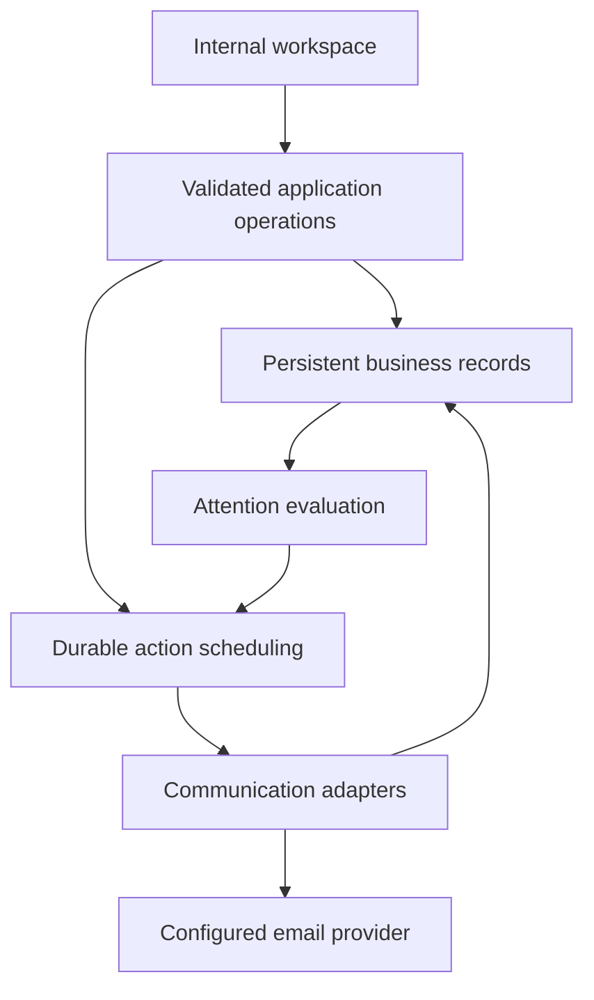

# System design — proposed
Revision 24. Supporting requirements REQ-014–026, NFR-001–004. No adopted deployment/runtime.
Recommendation: one modular application with persistent storage and durable background execution. Alternative independently deployed services add operational cost without known team/scale need. Synchronous-only request processing cannot cover inactivity timers reliably. Stack/hosting remains OQ-012.

This diagram is logical, not selected infrastructure. Read-only measurement consumes source facts; it does not mutate ownership. External intake is a narrow validated boundary into capture operations. Customer public access is outside this release.
Consistency: assignment/acceptance must commit atomically with version checks; notification delivery may lag and must have independent status. Event-outbox/storage strategy is proposed, not selected.
Security: authenticated internal access; integrity checks for expected assignment and accepting identity; no secret/provider tokens in histories. Different internal views do not imply role restrictions.
Failure: persistence failure prevents false mutation success; provider failure preserves valid assignment, exposes delivery problem; attention freshness/unknown source state visible.
See MODULE_BOUNDARIES, DATA_CONTRACTS, INTEGRATION_DESIGN and detailed modules. Candidate interfaces are in ../08_interfaces; concrete protocol/locations remain unresolved.
